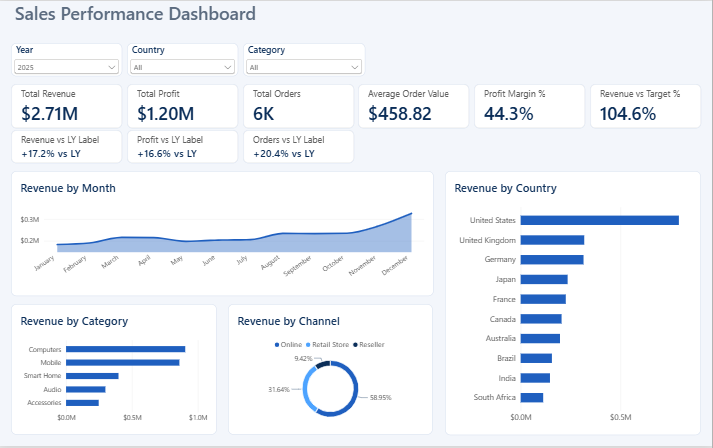
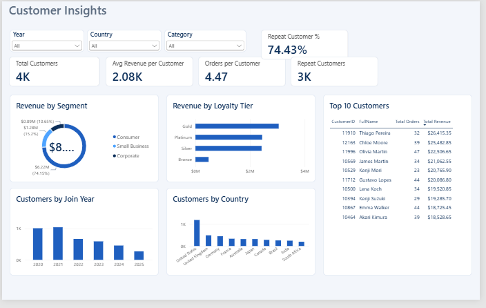
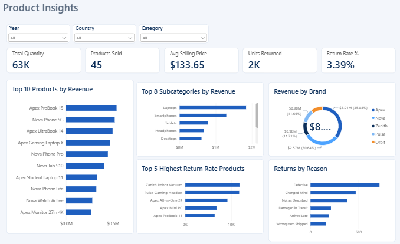
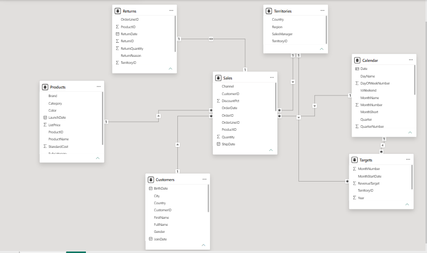

# Sales Performance Dashboard (Power BI)

An interactive three-page Power BI dashboard that analyses sales, customers and products for **Apex Global Retail**, a fictional consumer-electronics company selling in 10 countries between 2022 and 2025.



## Business questions answered
- How are revenue, profit and orders trending, and how do they compare with last year and with target?
- Which countries, product categories and sales channels drive revenue?
- Who are the most valuable customers, and how many of them come back to buy again?
- Which products are returned most often, and why?

## Dashboard pages

### 1. Sales
KPI cards (revenue, profit, orders, average order value, profit margin, revenue vs target) with year-over-year labels, plus revenue by month, country, category and channel.


### 2. Customer
Customer count, average revenue per customer, orders per customer and repeat-customer rate, with revenue by segment and loyalty tier, customers by join year and country, and the top 10 customers.



### 3. Product
Units sold, products sold, average selling price and return metrics, with the top 10 products, revenue by subcategory and brand, the products with the highest return rates, and returns by reason.



All three pages share synced Year, Country and Category slicers.

## Key insights
- Revenue of **$8.39M** and profit of **$3.75M** (44.6% margin) from 18,002 orders and 4,028 customers.
- Revenue grew **31.1%** in 2023, **20.5%** in 2024 and **17.2%** in 2025.
- November and December are the peak months.
- Online generates about **54%** of revenue, Retail Store 36% and Reseller 10%.
- Computers is the largest category by revenue; Smart Home is the fastest-growing.
- About **74%** of customers ordered more than once, and the Gold loyalty tier brings the most revenue (about 36%).
- The overall return rate is **3.39%** of units. Pulse Gaming Headset and Zenith Robot Vacuum are returned most (about 11.7% of units each), and "Defective" is the most common reason.
- Overall revenue was **107.5%** of target.

## Data model
A star schema with `Sales` as the fact table, connected to `Customers`, `Products`, `Territories` and `Calendar`. `Returns` links to `Sales` by order line, and `Targets` links to `Territories` and `Calendar`.



## Selected DAX measures
```DAX
Total Revenue = SUMX(Sales, Sales[Quantity] * Sales[UnitPrice] * (1 - Sales[DiscountPct]))

Total Profit = [Total Revenue] - [Total Cost]

Revenue LY = CALCULATE([Total Revenue], SAMEPERIODLASTYEAR(Calendar[Date]))

Revenue YoY % = DIVIDE([Total Revenue] - [Revenue LY], [Revenue LY])

Return Rate % = DIVIDE([Units Returned], [Total Quantity])

Repeat Customers =
COUNTROWS(
    FILTER(
        VALUES(Sales[CustomerID]),
        CALCULATE(DISTINCTCOUNT(Sales[OrderID])) >= 2
    )
)
```

## Dataset
A synthetic dataset created for this project (no real customers or transactions), with seven tables:

| Table | Rows |
|---|---|
| Sales | 37,887 |
| Customers | 5,200 |
| Products | 45 |
| Territories | 10 |
| Calendar | 1,461 |
| Returns | 1,483 |
| Targets | 480 |

The data is in `data/Apex_Global_Sales_Dataset.xlsx`.

## Tools and skills
Power BI Desktop, Power Query, DAX (including time intelligence), data modelling (star schema), custom theme, synced slicers and dashboard design.

## How to open
1. Install Power BI Desktop (free).
2. Download `Sales_Dashboard.pbix` from this repository and open it.
3. If Power BI asks for the data source, point it to `data/Apex_Global_Sales_Dataset.xlsx`.

## Author
Nyasha Muza- https://www.linkedin.com/in/nyasha-muza-799466272
